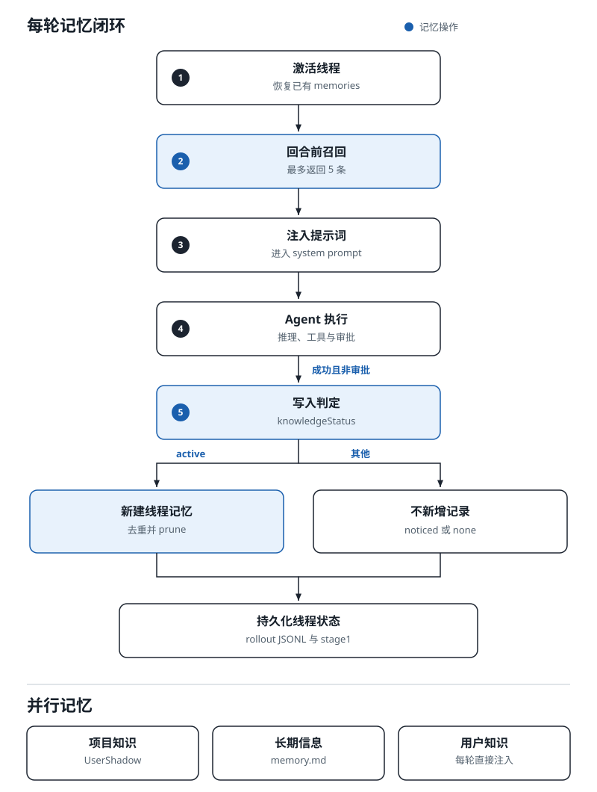
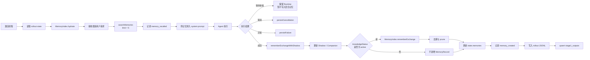
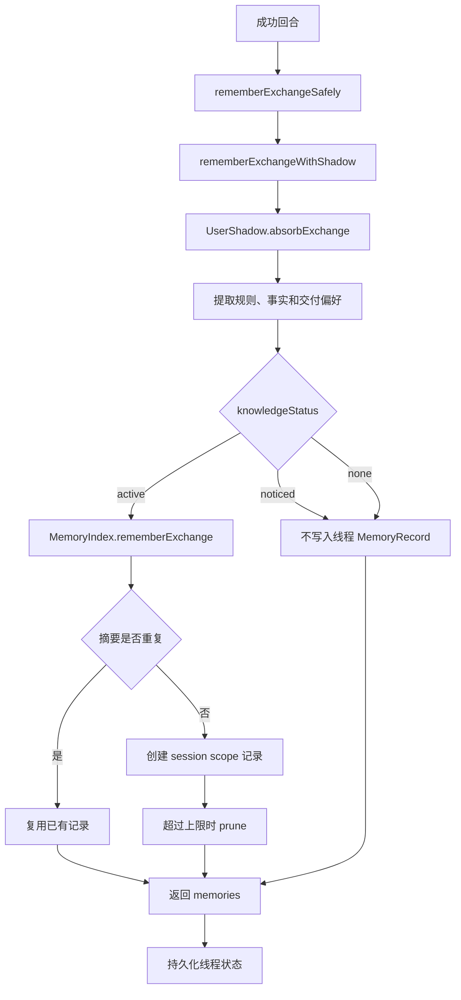
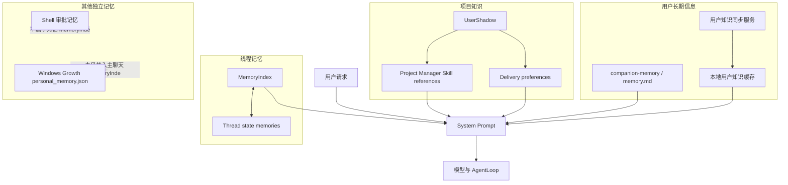
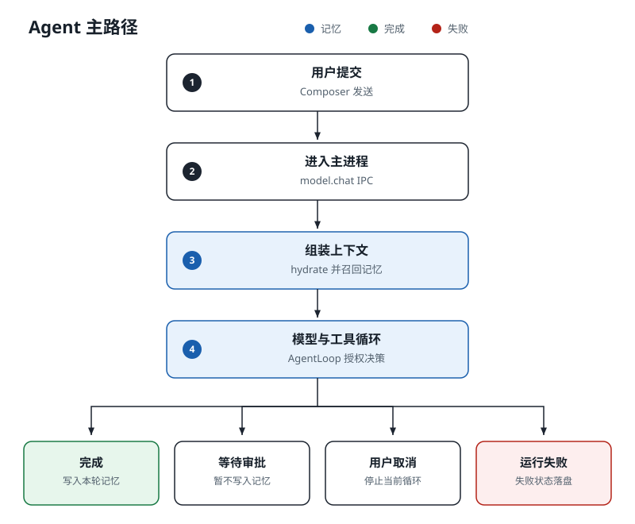
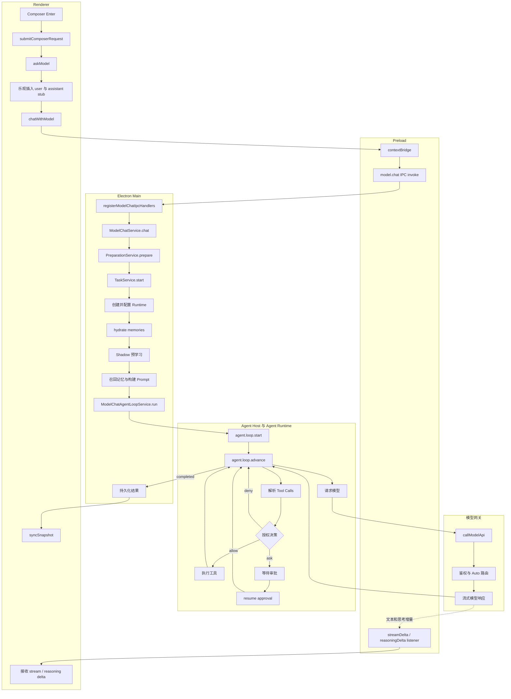
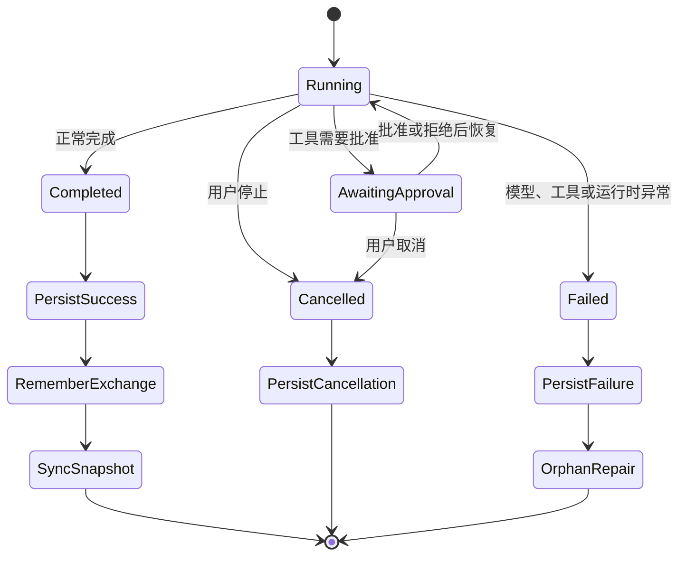

# NewBrain 记忆模式与 Agent 逻辑流程

本文基于 BRAIN 当前 `shared/` 源码与平台 overlay 梳理，不以 `.materialized/` 生成目录为源码依据。

## 1. 结论

NewBrain 当前没有真正可切换的“记忆模式”：

- `threads.memory_mode` 字段已经存在，创建线程时默认写入 `enabled`。
- 当前没有发现基于 `memory_mode` 的运行时判断、设置开关或单条记忆管理 UI。
- 实际记忆能力由线程 `MemoryIndex`、`UserShadow`、项目 PM Skill、`companion-memory` 和用户知识同步等多条链路共同组成。
- 线程记忆检索是关键词重叠启发式检索，不是向量检索。

## 2. 每轮记忆闭环





### 2.1 召回阶段

1. 激活线程时，从线程状态读取 `memories[]`。
2. `runtime.setThreadState` 调用 `memoryIndex.hydrate` 恢复运行时索引。
3. 每轮对话开始前，以最新用户请求调用：

   ```text
   runtime.searchMemories(latestUserRequest, { limit: 5 })
   ```

4. 命中结果写入 `memory_recalled` 线程事件。
5. 召回结果以 `[scope] summary` 形式拼入 system prompt。

主要实现：

- `shared/apps/desktop/src/main/model-chat-service.ts`
- `shared/apps/desktop/src/main/model-chat-context-service.ts`
- `shared/apps/desktop/src/main/model-chat-prompt-policy.ts`
- `shared/apps/agentd/src/memory-index.js`
- `platforms/windows/apps/agentd/src/runtime.js`

### 2.2 写入阶段

只有回合成功且没有处于等待审批状态时，才进入回合记忆写入：



重要分支：

- `knowledgeStatus === "active"` 时才新增线程 `MemoryRecord`。
- `noticed` 或 `none` 不新增线程记忆，但 Shadow 或 companion 文件仍可能更新。
- 用户消息或助手消息为空时不创建记忆。
- 摘要完全重复时复用已有记录。
- `rememberExchangeSafely` 会吞掉记忆写入异常，记忆失败不会阻断当前对话。
- 等待工具审批时不执行本轮记忆写入。

## 3. 多层记忆结构



### 3.1 线程 MemoryIndex

- 作用域：当前线程。
- 运行位置：Agent Runtime 内存。
- 跨重启来源：线程 rollout 中的 `memories[]`。
- 自动写入使用 `session` scope。
- 类型支持 `user`、`workspace`、`session`，但自动回合路径主要使用 `session`。

### 3.2 UserShadow 与项目 PM Skill

用于学习和保存：

- 用户输出规则；
- 项目知识；
- session digest；
- 待学习问题；
- 交付偏好。

主要文件：

- `shared/apps/agentd/src/user-shadow.js`
- `<project>/.newbrain/skills/<project>-project-manager/references/*.md`
- `<project>/.newbrain/skills/<project>-project-manager/references/delivery-preferences.json`

### 3.3 companion-memory

- 保存称呼、城市等用户级长期信息。
- 存储为 `<userSkillRoot>/companion-memory/references/memory.md`。
- 与线程 `MemoryIndex` 独立。
- 通过 Skill 加载进入模型上下文。

主要实现：

- `shared/apps/agentd/src/companion-memory.js`
- `shared/apps/desktop/src/main/model-chat-skill-policy.ts`

### 3.4 用户知识同步

- 设置页提供“立即同步用户知识”操作。
- 每轮对话从本地知识文件读取并注入模型上下文。
- 该链路不经过 `MemoryIndex.search`。

主要实现：

- `shared/apps/desktop/src/main/user-knowledge-sync.ts`
- `shared/apps/desktop/src/renderer/app/SettingsWorkspace.tsx`

### 3.5 审批记忆

`approval-memory.ts` 保存 Shell 命令批准规则，与对话记忆不是同一系统。

## 4. 记忆召回算法

`MemoryIndex.search` 当前采用词项重叠启发式算法：

1. 对最新用户请求生成 query terms。
2. 对记忆摘要进行词项匹配和打分。
3. 只有 `score >= 10` 的记录才会返回。
4. 默认最多返回 5 条。
5. query terms 为空时，按更新时间返回最近记录。

因此当前能力具有以下特点：

- 不需要向量数据库或 embedding 服务；
- 对字面关键词重复较敏感；
- 对同义表达、跨语言表达和抽象语义的召回能力有限；
- 没有发现模型可主动调用的 `memory.search` 或 `memory.get` 工具实现。

## 5. Agent 主逻辑流程





## 6. Agent 结果分支



### 正常完成

1. `persistSuccess`；
2. `rememberExchangeWithShadow`；
3. 更新 `state.memories`；
4. 同步 UI 快照；
5. 如果同一线程存在排队请求，执行下一条。

### 等待审批

- 保留当前 task 和 runtime；
- 写入运行边界事件和审批状态；
- 暂不写入本轮对话记忆；
- 用户批准或拒绝后调用 `resumeAgentApproval` 继续循环。

### 用户取消

- Abort 当前请求；
- 调用 `cancelAgentLoop`；
- 写入 `persistCancellation`；
- Renderer 将请求标记为用户取消。

### 异常

- 调用 `persistFailure`；
- 尝试修复孤立运行状态；
- Renderer 展示失败卡片，并从后续模型上下文排除失败占位内容。

## 7. 持久化地图

| 数据 | 位置 | 作用 |
| --- | --- | --- |
| 线程状态与事件 | `.newbrain/workspaces/<id>/threads/<threadId>.rollout.jsonl` | 保存 messages、memories、events、timeline，是线程恢复的权威来源 |
| 线程目录 | `.newbrain/state_5.sqlite` | 保存 threads 元数据和 `memory_mode` |
| Memory Stage 1 | `.newbrain/memories_1.sqlite` 的 `stage1_outputs` | 保存 raw memory 和 rollout summary |
| 项目知识 | `<project>/.newbrain/skills/<project>-project-manager/references/*` | 保存项目知识、用户规则和交付偏好 |
| Companion 记忆 | `<userSkillRoot>/companion-memory/references/memory.md` | 保存用户级长期信息 |
| Windows Growth 记忆 | `{userData}/growth/personal_memory.json` | Growth Hub 的独立个人记忆 |

需要注意：

- `MemoryIndex` 本身只存在于 Agent 进程内存中。
- rollout 中的 `memories[]` 是线程记忆的跨重启来源。
- `stage1_outputs` 当前可见写入与删除逻辑，但未发现 phase 2 消费 Worker。
- 删除线程时会清理对应 `stage1_outputs`。
- 没有发现编辑或删除单条线程记忆的 API/UI。

## 8. 关键源码索引

### 记忆

- `shared/apps/agentd/src/memory-index.js`
- `shared/apps/agentd/src/user-shadow.js`
- `shared/apps/agentd/src/companion-memory.js`
- `shared/apps/agentd/src/context-capsule.js`
- `shared/apps/desktop/src/main/remember-exchange-safely.ts`
- `shared/apps/desktop/src/main/model-chat-context-service.ts`
- `shared/apps/desktop/src/main/model-chat-success-service.ts`
- `shared/apps/desktop/src/main/model-chat-prompt-policy.ts`
- `shared/apps/desktop/src/main/thread-state-service.ts`
- `shared/apps/desktop/src/main/user-knowledge-sync.ts`
- `platforms/windows/apps/agentd/src/runtime.js`
- `platforms/windows/apps/desktop/src/main/codex-storage.ts`

### Agent 主流程

- `shared/apps/desktop/src/renderer/app/WorkspaceModules.tsx`
- `platforms/windows/apps/desktop/src/renderer/ui.tsx`
- `platforms/windows/apps/desktop/src/preload/index.ts`
- `shared/apps/desktop/src/main/model-chat-ipc.ts`
- `shared/apps/desktop/src/main/model-chat-service.ts`
- `shared/apps/desktop/src/main/model-chat-preparation-service.ts`
- `shared/apps/desktop/src/main/model-chat-task-service.ts`
- `shared/apps/desktop/src/main/model-chat-agent-loop-service.ts`
- `shared/apps/desktop/src/main/model-chat-run-persistence-service.ts`
- `shared/apps/desktop/src/main/agent-host-loop-bridge.ts`
- `shared/apps/desktop/src/main/agent-host-runtime.ts`
- `shared/apps/desktop/src/main/agent-host-entry.ts`
- `platforms/windows/apps/agentd/src/agent-loop.js`

## 9. 当前缺口

1. `memory_mode` 尚未接入真实运行时控制。
2. 没有线程记忆开关和单条记忆编辑、删除 UI。
3. `memory.search`、`memory.get` 仅发现边界名称，未发现完整工具注册和处理器。
4. `stage1_outputs` 未发现 phase 2 消费实现。
5. 自动回合记忆主要写入 `session` scope，`user` 和 `workspace` scope 使用有限。
6. MemoryIndex 依赖字面词项重叠，缺少语义向量召回。
7. Holon、Growth personal memory 与主聊天 MemoryIndex 没有发现自动合并路径。

